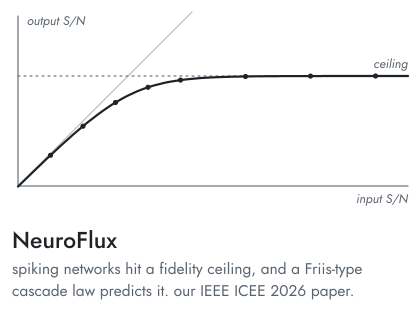
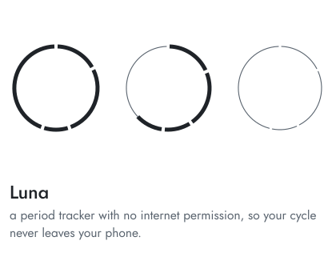
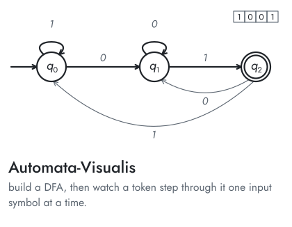
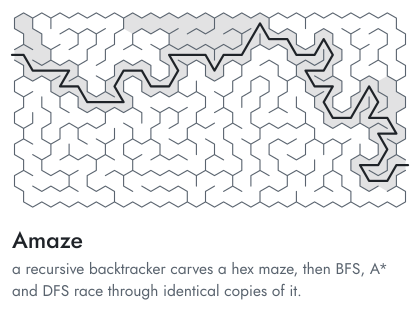

<!-- generated by art/plates.py: change the words there, then run it -->

<picture><source media="(prefers-color-scheme: dark)" srcset="https://raw.githubusercontent.com/ahadullabaig/ahadullabaig/main/art/ahad-dark.svg"></picture>
<picture><source media="(prefers-color-scheme: dark)" srcset="https://raw.githubusercontent.com/ahadullabaig/ahadullabaig/main/art/lead-dark.svg"></picture> 
<a href="https://github.com/ahadullabaig/NeuroFlux"><picture><source media="(prefers-color-scheme: dark)" srcset="https://raw.githubusercontent.com/ahadullabaig/ahadullabaig/main/art/neuroflux-dark.svg"></picture></a><a href="https://github.com/ahadullabaig/Luna"><picture><source media="(prefers-color-scheme: dark)" srcset="https://raw.githubusercontent.com/ahadullabaig/ahadullabaig/main/art/luna-dark.svg"></picture></a>
<a href="https://github.com/ahadullabaig/Automata-Visualis"><picture><source media="(prefers-color-scheme: dark)" srcset="https://raw.githubusercontent.com/ahadullabaig/ahadullabaig/main/art/automata-dark.svg"></picture></a><a href="https://github.com/ahadullabaig/Amaze"><picture><source media="(prefers-color-scheme: dark)" srcset="https://raw.githubusercontent.com/ahadullabaig/ahadullabaig/main/art/amaze-dark.svg"></picture></a>
<a href="mailto:ahadullabaig.16@gmail.com"><picture><source media="(prefers-color-scheme: dark)" srcset="https://raw.githubusercontent.com/ahadullabaig/ahadullabaig/main/art/email-dark.svg"></picture></a><a href="https://www.linkedin.com/in/ahadullabaig/"><picture><source media="(prefers-color-scheme: dark)" srcset="https://raw.githubusercontent.com/ahadullabaig/ahadullabaig/main/art/linkedin-dark.svg"></picture></a>

